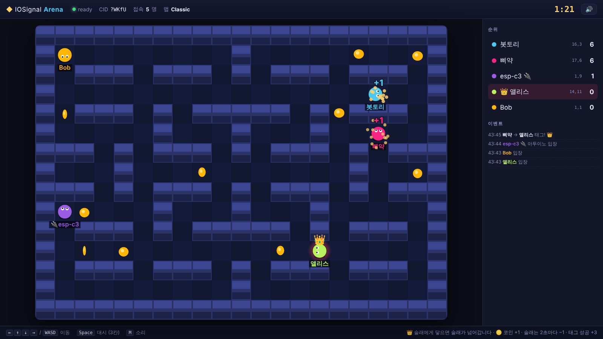
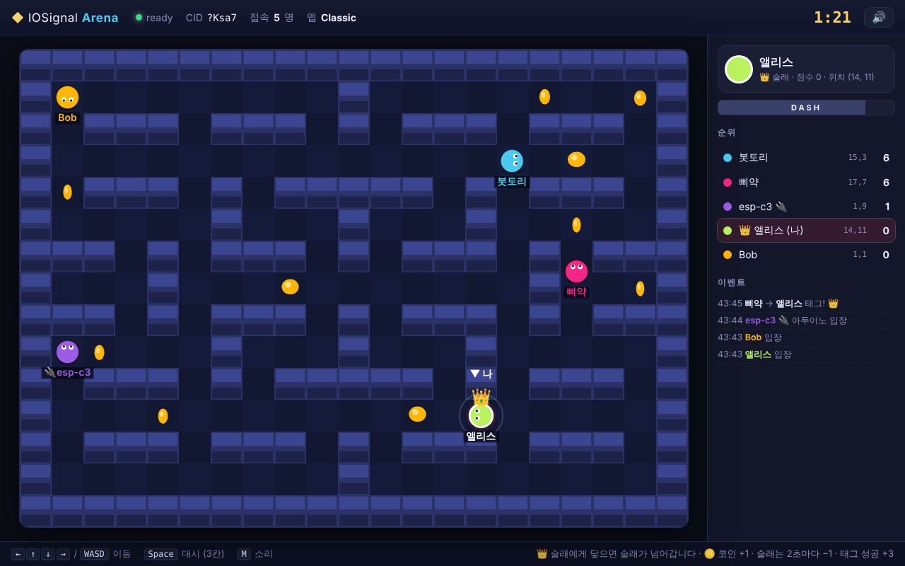
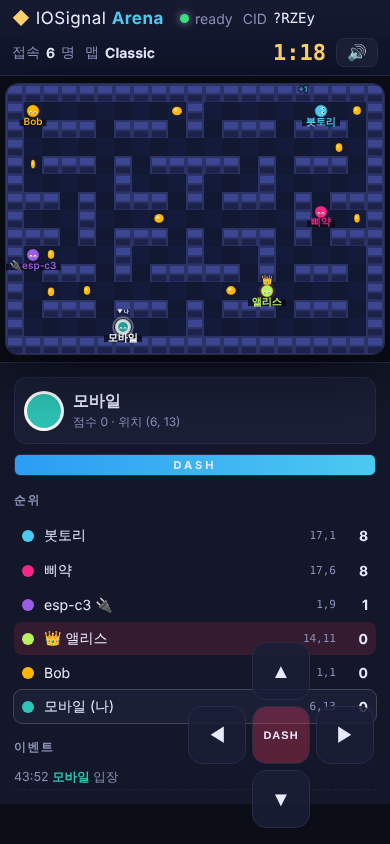

# IOSignal Arena — 멀티유저 코인 술래잡기

IOSignal 서버를 중계기로 사용하는 실시간 멀티플레이어 게임 예제입니다. 여러 웹 브라우저와 **ESP32-C3 Super Mini 버튼 컨트롤러**가 같은 미로에 접속합니다. 모든 참가자가 같은 맵에서 자신과 상대의 위치를 보며 방향키로 움직이고, 술래를 주고받습니다. 결과는 화면 효과와 소리로 피드백됩니다.

<p align="center">
  
</p>

| 플레이어 화면 | 모바일 (터치 D-pad) |
|---|---|
|  |  |

## 구성

```
 브라우저 N개 ── WebSocket /ws ──┐
                                 ├─ IOSignal Server
 ESP32-C3 N개 ── TCP 55488 ──────┘        │
                                          └─ 게임 호스트 server.host('arena') (서버 안)
                                             · 입력 수신(보낸 CID는 서버가 알려 줌) → 이동·충돌·술래·점수 판정
                                             · arena#state 스냅샷(변화 즉시 + 15Hz) / arena#$roster 명단 / arena#evt 이벤트 발행
                                             · 아두이노에는 "@fx" 직접 시그널로 피드백
                                             · 연결이 끊긴 플레이어는 바로 퇴장
```

- **게임 서버** `server.mjs` → `src/arena-server.mjs`는 HTTP 정적 서버와 IOSignal `Server({ httpServer, wsPath: '/ws', congPort })`를 한 프로세스에서 실행합니다.
- **게임 호스트**는 `ioServer.host('arena', { inbound: ['arena#in'], own: [...] })`로 서버 안에 등록합니다. `arena#in`으로 온 입력은 호스트에게만 가고, 서버가 확인한 보낸 사람(`from.cid`)이 함께 옵니다. `arena#state`, `arena#$roster`, `arena#evt`, `@fx`는 호스트만 보낼 수 있어 클라이언트가 위조할 수 없습니다. 규칙은 `src/game.mjs`(네트워크 없는 순수 로직)에 있습니다.
- **IOSignal 버전**: npm `iosignal` 10.3.0을 씁니다(`server.host()`는 9.13.0, 대시보드는 9.14.0부터). 10.3.0부터 직접 만든 `Server`는 기본으로 아무것도 제한하지 않습니다(쿼터 프로필, 주소별 연결 수 제한 없음).
- **웹앱** `public/`은 빌드 없이 동작합니다. `/vendor/io.js`(IOSignal IIFE)와 `protocol.js`(서버와 공유하는 맵·규칙·태그)를 사용합니다.
- **아두이노** `arduino/arena_controller/arena_controller.ino`는 화면이 없는 버튼 컨트롤러입니다. 공용 화면(`?watch`)을 보며 조작합니다.

## 빠른 시작

Node.js 22.16 이상이 필요합니다.

```sh
cd iosignal_arena-game
npm ci
npm start
```

| 주소 | 용도 |
|---|---|
| `http://localhost:5178` | 플레이어 화면. 창을 여러 개 열어 각각 입장하세요. |
| `http://localhost:5178/?watch` | 관전 화면. 큰 모니터에 띄워 두면 아두이노 사용자가 이 화면을 보고 플레이합니다. 옆 패널에 스마트폰 접속 QR 코드와 주소가 나옵니다. |
| `http://localhost:5178/dashboard` | 서버 대시보드(아래) |
| `ws://localhost:5178/ws` | 브라우저용 IOSignal WebSocket |
| TCP `55488` | 아두이노용 IOSignal CongSocket |

시작하면 터미널에 같은 공유기의 다른 기기에서 접속할 LAN 주소가 출력됩니다. 이 주소를 아두이노 `SERVER_HOST`에도 사용합니다.

혼자 테스트할 때는 다른 터미널에서 봇을 추가할 수 있습니다.

```sh
npm run bots            # 봇 3개
node scripts/bots.mjs 5 ws://192.168.0.10:5178/ws
```

포트는 환경 변수로 바꿉니다: `PORT=6000 CONG_PORT=56000 npm start` · 프록시 뒤에서 QR에 넣을 주소: `PUBLIC_URL=https://lab.iosignal.net/games/arena/ npm start`

### 서버 대시보드

`http://localhost:5178/dashboard`에서 서버 상태를 실시간 그래프로 봅니다(iosignal 9.14.0의 `dashboard`). CPU·메모리·이벤트 루프 지연, 트래픽, 게임 호스트의 참가자·초당 입력·위조 차단, 게임 루프의 틱 간격(`host.loop`), 게임 정보(맵, 경기·순위 발표, 남은 시간, 참가자 수, 술래, 코인 수, 1등)가 나옵니다. 참가자 CID는 앞 두 글자만 보입니다.

- 끄기: `DASHBOARD=off npm start`
- 토큰으로 잠그기: `DASHBOARD_TOKEN=원하는토큰8자이상 npm start` (페이지에서 토큰 입력, 또는 주소 뒤에 `?key=토큰`)

## 게임 규칙

- 21×15 미로 3종(Classic → Rooms → Cross)을 라운드마다 순환합니다. 한 라운드는 90초입니다.
- 이동은 칸 단위입니다. 키를 한 번 누르면 1칸, 누르고 있으면 0.14초마다 1칸씩 이동합니다.
- **술래(👑)** 는 2명 이상일 때 1명이 정해집니다. 술래와 닿으면(어느 쪽이 부딪쳐도) 술래가 넘어갑니다.
  - 넘겨준 사람: **+3점**, 1.5초 무적(깜빡임)
  - 새 술래: 1초 기절(★). 술래인 동안 2초마다 −1점
- **코인 🪙** +1점. 맵에는 항상 10개가 유지됩니다.
- 술래가 아닌 사람끼리는 같은 칸에 들어갈 수 없습니다(부딪힘 효과).
- **대시**: 바라보는 방향으로 최대 3칸 순간 이동하며, 쿨다운은 4초입니다.
- 라운드가 끝나면 순위를 7초간 보여준 뒤 다음 맵으로 넘어갑니다. 입력이 6초 동안 없으면 퇴장 처리됩니다.

## 조작과 피드백

| | 이동 | 대시 | 피드백 |
|---|---|---|---|
| 웹 (PC) | 방향키 / WASD | Space | 캔버스 이펙트, 화면 흔들림, WebAudio 효과음, `M` 소리 끄기 |
| 웹 (모바일) | 화면 D-pad | DASH 버튼 | 위와 같음 |
| ESP32-C3 | GPIO3(↑)/0(↓)/2(←)/1(→) 버튼 | GPIO5 또는 BOOT(GPIO9) | LED(GPIO6) + 패시브 부저(GPIO4) |

웹 화면에서는 내 캐릭터에 흰 테두리, 퍼지는 링, `▼ 나` 표시가 붙습니다. 상대는 고유 색상과 이름표로, 아두이노 사용자는 🔌로 표시됩니다. 순위 목록에서도 모두의 좌표를 볼 수 있습니다. 술래가 3칸 이내로 다가오면 화면 가장자리가 붉게 변하고 심장 박동 소리가 납니다.

## 아두이노 컨트롤러 (ESP32-C3 Super Mini)

### 배선

모든 버튼은 GPIO와 GND 사이에 연결합니다(내부 풀업 사용).

| 기능 | GPIO | 비고 |
|---|---|---|
| UP | 3 | |
| DOWN | 0 | |
| LEFT | 2 | 스트래핑 핀: 전원 투입·리셋 순간에는 누르지 마세요 |
| RIGHT | 1 | |
| ACTION (대시) | 5 | 보드의 BOOT 버튼(GPIO9)도 대시로 동작 |
| 패시브 부저 | 4 | 부저(+) ← GPIO4, 부저(−) → GND. 100Ω 직렬 저항 권장 |
| LED | 6 | GPIO6 → 330Ω → LED(+), LED(−) → GND (active HIGH). 내장 LED(GPIO8, active LOW)를 쓰려면 `PIN_LED = 8`, `LED_ACTIVE_LOW = true` |

GPIO2는 부팅 모드를 정하는 스트래핑 핀이라 내부 풀업으로 평소에는 문제없지만, 부팅 순간 LEFT를 누르고 있으면 정상 부팅되지 않을 수 있습니다. 보드 제품마다 핀 배치가 다를 수 있으니 스케치 상단의 핀 번호를 확인하세요.

### 업로드

1. 라이브러리 매니저에서 **IOSignal(6.0.1 이상), Boho, Crypto, Bounce2**를 설치합니다(Remocon 라이브러리를 설치하면 함께 설치됨).
2. 보드는 **ESP32C3 Dev Module**(esp32 core 3.x)을 선택하고 **Tools > USB CDC On Boot: Enabled**로 설정합니다.
3. 스케치 상단의 `WIFI_SSID`, `WIFI_PASS`, `SERVER_HOST`(서버 PC의 LAN IP), 필요하면 `PLAYER_NAME`을 수정합니다. 이름을 비워 두면 `esp-xxxx`가 사용됩니다.
4. 업로드 후 시리얼 모니터(115200)에서 `[io] ready cid=...`를 확인하면 관전 화면에 🔌 플레이어가 나타납니다.

PC와 ESP32는 같은 공유기에 연결되어 있어야 합니다. 접속이 되지 않으면 PC 방화벽에서 TCP 55488 인바운드를 허용하세요.

### 장치 피드백

| `@fx` | 소리 | LED |
|---|---|---|
| `join` | 도-미-솔 | 2회 깜빡 |
| `coin` | 띠링 | 1회 짧게 |
| `it` (내가 술래) | 사이렌 | **술래인 동안 계속 켜짐** |
| `free` (술래 탈출) | 상승음 | 꺼짐 |
| `near` (술래가 3칸 이내) | 짧은 경고음 반복 | 깜빡 |
| `bump` / `wall` | 낮은 쿵 / 짧은 틱 | 부딪힘만 깜빡 |
| `dash` / `nodash` | 슝 / 낮은 삑(쿨다운 중) | |
| `start` / `end` / `win` | 시작음 / 종료음 / 팡파레 | |

연결 전이나 끊긴 동안에는 LED가 0.5초 간격으로 깜빡입니다. 재접속하면 새 CID로 자동 재입장합니다.

## 통신 프로토콜

| 태그 | 방향 | 페이로드 |
|---|---|---|
| `arena#in` | 모든 클라이언트 → 게임 호스트 | TEXT `"OP,args"`. 다른 구독자에게 전달되지 않음 |
| `arena#state` | 게임 호스트 → 구독자 | OBJECT 스냅샷(위치·점수 등 변하는 값만). 상태가 바뀌면 즉시(최소 16ms 간격), 변화가 없으면 66ms 간격 |
| `arena#$roster` | 게임 호스트 → 구독자 | OBJECT 명단 `{ p: [[cid, name, color, kind], ...] }`. 입장·퇴장 때만 발행하며, `$`가 붙은 retain 태그라 나중에 구독한 클라이언트도 즉시 받습니다. |
| `arena#evt` | 게임 호스트 → 구독자 | OBJECT 이벤트 (`join`, `leave`, `coin`, `tag`, `bump`, `dash`, `round`) |
| `<cid>@fx` | 게임 호스트 → 장치 1대 | TEXT 피드백 단어. 받는 쪽 태그는 `@fx`이며 구독할 필요가 없습니다. |

입력은 아두이노가 `snprintf`로 만들 수 있도록 텍스트 한 줄로 정했습니다. 보낸 사람은 서버가 호스트에게 알려 주므로 페이로드에 CID를 넣지 않습니다.

```
J,web,앨리스     입장 (kind: web | ard | bot)
D,U              누르고 있는 방향 (U D L R, 0 = 뗌)
A                대시
H                하트비트 (2초)
L                퇴장
```

예전 형식 `"<cid>,OP,args"`는 받지 않습니다. 그 형식으로 펌웨어를 올린 ESP32는 이 스케치로 다시 올려야 합니다.

스냅샷 예: `{ ph: 'play', map: 0, left: 81234, it: '?c3d4', p: [[cid, x, y, score, flags, dashLeftMs], ...], c: [coinCellIndex, ...] }`

이름·색·종류는 매번 바뀌지 않으므로 스냅샷에서 빼고 `arena#$roster`로 따로 보냅니다. 웹은 `expandSnapshot()`(`protocol.js`)으로 둘을 합쳐 `[cid, name, color, kind, x, y, score, flags, dashLeftMs]` 형태로 사용합니다.

맵은 `protocol.js`에 고정되어 서버와 웹이 같은 파일을 import하므로 스냅샷에는 맵 번호만 포함됩니다. 웹은 스냅샷 사이의 위치를 보간해 부드럽게 그립니다.

## 파일 구조

| 파일 | 역할 |
|---|---|
| `server.mjs` | 실행 진입점, 주소·LAN IP 출력, 종료 처리 |
| `src/arena-server.mjs` | HTTP 정적 서버 + IOSignal Server(WS·TCP) + 게임 호스트(`server.host`) |
| `src/game.mjs` | 게임 규칙(이동, 충돌, 술래, 코인, 대시, 라운드, 타임아웃, 아두이노 레이더) |
| `public/protocol.js` | 서버·웹 공유: 태그, 규칙 수치, 맵, 입력 형식 |
| `public/app.js` | 웹 클라이언트: 연결, 입력, 렌더링, 이펙트, HUD |
| `public/sound.js` | WebAudio 효과음 합성(음원 파일 없음) |
| `public/index.html`, `style.css` | 화면 구성, 관전 모드, 모바일 D-pad |
| `arduino/arena_controller/` | ESP32-C3 버튼 컨트롤러 스케치 |
| `scripts/bots.mjs` | 테스트·시연용 봇(BFS로 코인 추적, 술래 회피) |
| `scripts/perf.mjs`, `perf-server.mjs` | 성능 측정: 중계 지연·처리량, 부하별 입력→화면 지연, 스냅샷 빈도, 서버 CPU (`npm run perf`, `--quick`) |
| `test/*.test.mjs` | 게임 로직 단위 테스트, WS + CongSocket 실제 소켓 스모크 테스트, 입력 위조·출력 위조·즉시 퇴장 확인 |
| `scripts/browser-test.mjs` | 브라우저 3창 + 가짜 아두이노 + 봇 E2E, 스크린샷 생성 |
| `../game-kit/` | IOSignal 게임 키트(모든 게임 공통): 상단의 IOSignal 배지·연결 칩(상태, 왕복 시간, 참가자)·📱 참여 버튼(QR, 주소, 공유), 큰 화면 QR 카드, `/join`·`/qr.svg`·`/kit/*` |

## 테스트

```sh
npm test               # 게임 로직 + 실제 소켓(웹 WebSocket, 아두이노와 같은 TCP 텍스트) 스모크
npm run test:browser   # Chrome 플레이어 2창 + 관전 1창 + 모바일 + 가짜 ESP32 + 봇 2개
```

`test:browser`는 `playwright` 또는 `playwright-core` + `CHROME_PATH`를 사용합니다.

## 예제의 범위

- 보낸 사람은 서버가 확인하므로 다른 플레이어 대신 입력할 수 없습니다. 다만 익명 접속은 재접속할 때마다 CID가 바뀌므로 같은 사람임을 보장하려면 IOSignal 인증을 사용하세요.
- 게임 호스트는 서버 프로세스 안에서 동작하므로 이 예제는 자기 IOSignal 서버로 실행합니다. 공개 서버(`wss://io.iosignal.net/ws`)에는 호스트를 등록할 수 없습니다.
- 상태는 메모리에만 있으며 서버를 재시작하면 초기화됩니다. 접속 중이던 클라이언트는 자동으로 재입장합니다.

## 검증 기록 (2026-11-14, iosignal 9.14.0 대시보드)

- 개발판 tgz 대신 npm `iosignal` 9.14.0을 쓰도록 바꾸고 tgz를 지움. `dashboard`, `host.loop`(30ms), `host.report`를 적용. `npm test` 10개 통과(소켓 시험이 `/dashboard`와 호스트 정보 확인).

## 검증 기록 (2026-11-13, iosignal 9.13.0 개발판, server.host)

- GameMaster 클라이언트를 `server.host('arena')`로 바꿈. 입력은 `"OP,args"`(예전 `"cid,OP,args"`는 받지 않음), 연결이 끊기면 바로 퇴장, 출력 태그는 호스트만 보냄.
- `npm test` 10개 통과(새 스모크: 남의 CID를 넣은 입력은 거부되고 다른 플레이어에게 영향 없음, 클라이언트가 보낸 `arena#state`·`<cid>@fx`는 전달되지 않음, 연결 종료 시 즉시 퇴장).
- 내장 브라우저로 관전·플레이 화면 확인: 봇 3개 + 웹 1명 입장, 명단·이벤트·지도 갱신, 콘솔 오류 없음. 봇 프로세스를 끝내자 서버 로그에 `(close)`로 바로 퇴장.
- `npm run perf -- --quick`: 12명 + 관전 50명에서 입력→스냅샷 p50 3.6ms / p95 14.7ms, 서버 CPU 6.8%, 스냅샷 343B. 예전 GameMaster 방식과 같은 조건의 기록이 없어 비교하지 않았습니다.
- 스케치는 `arduino-cli compile --fqbn esp32:esp32:esp32c3`(IOSignal 9.13.0) 통과. 실기기는 검증하지 않았습니다. `npm run test:browser`는 README 스크린샷을 덮어쓰므로 실행하지 않았습니다.

## 검증 기록 (2026-11-03, iosignal 9.0.0)

- `iosignal@9.0.0`, Node.js 22.16.0
- `npm test` 9개 통과, `npm run test:browser`(Chrome, `CHROME_PATH`) 통과
- 9.0은 쿼터를 항상 적용합니다(익명 기본 100 msg/s). `npm run perf -- --quick`에서 12명 + 관전 50명일 때 게임 루프의 `rateLimited`는 0이었습니다.
- `scripts/perf-server.mjs`는 IOSignal 자체 중계 성능을 재도록 익명 쿼터를 제한 없음으로 띄웁니다(`startArena({ quotas })`). 일반 실행(`npm start`)은 9.0 기본 쿼터를 씁니다.
- (2026-11-29 덧붙임) iosignal 10.3.0부터는 기본 쿼터가 없어 일반 실행도 제한 없이 돌고, `perf-server.mjs`도 쿼터를 따로 풀지 않습니다.
- ESP32-C3 실기기는 이번에도 검증하지 않았습니다.

## 검증 기록 (2026-10-26)

- `iosignal@7.2.0`, Node.js 22.23
- `npm test` 9개 통과: 맵 연결성, 탭 이동, 코인, 태그·무적·기절, 대시 쿨다운, 타임아웃·라운드 순환, 아두이노 `start`→`it` 순서, WebSocket과 CongSocket(TCP)을 사용한 실제 플레이
- `npm run test:browser` 통과: 5명이 같은 상태를 공유, 키보드 이동이 다른 창에 동일 좌표로 표시, TCP 아두이노 이동과 `@fx` 수신, 대시 쿨다운, 모바일 D-pad, 390px에서 가로 스크롤 없음, 페이지 오류 없음
- 아두이노 스케치는 실제 `IOSignal.h`와 Bounce2 헤더로 호스트 컴파일(경고 0)만 확인했습니다. **ESP32-C3 실기기 업로드와 부저·버튼 동작은 아직 검증하지 않았습니다.**
